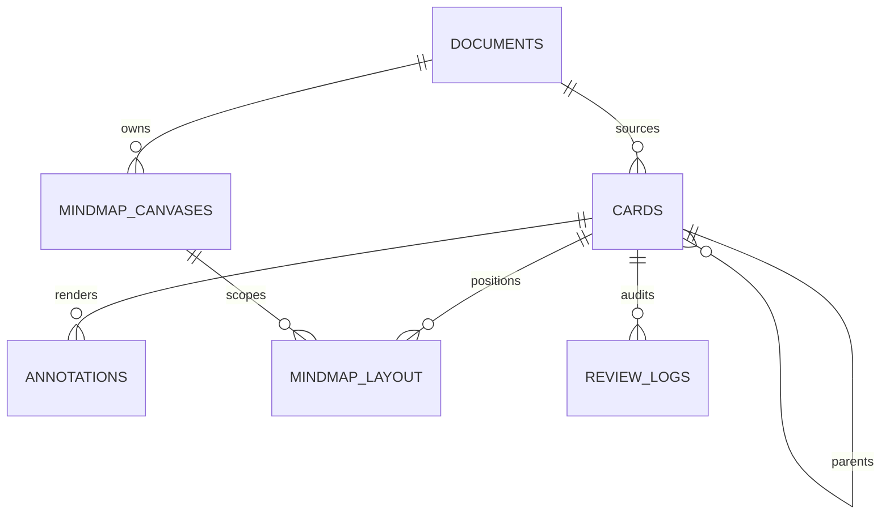

# PDFNote 架构基线（阶段 01 + 02）

版本：0.31.0  
状态：已落地工程骨架，OCR 为 macOS Apple Vision 单引擎，扫描页提供整页识别后的可选文字层；schema 升至 v9（`page_notes` 留白、`book_analysis`/`book_outline` 拆书、`mindmap_canvases` 多画布）。AI 拆书的两阶段提示词、节点预算与解析截断均由读者设置的 `depth`（1–5 层，默认 2）驱动，`outline_json` 记录本次深度；脑图卡片与大纲行的正文由 `ExpandableField` 统一渲染（长文本折叠 → 点击展开 → 限高滚动，AI 解析写回后自动展开，不改数据库）；0.20.0 起 `(canvas_id, card_id)` 决定卡片出现在哪张画布，`surface_mindmap` 是派生开关，并支持 AnkiDroid txt 按牌组建树导入；标题链接由本地关键词字典驱动；公式可选交给用户配置的视觉模型转 LaTeX（默认不联网），全视图提供应用内元素右键菜单；0.21.0 复习卡正面改为主动回忆输入框，揭示背面后用 `answerMatch.ts` 纯函数生成文本对比反馈（不落库、不参与 FSRS）；0.22.0 脑图超 60 节点启用视口裁剪（`onlyRenderVisibleElements`），子节点数改为工作区预算 `childCounts`，1483 张卡的画布从 8.4s 降到 0.9s；0.23.0 起缩放低于 45% 时节点降级为标题条、边不渲染、拖拽让给画布平移，避免 React Flow 逐帧重建上千个可见节点；0.24.0 新卡落点由右栏视口中心决定（`viewport.ts` 共享状态 + `create_card.x/y`），不再写死原点；0.25.0 起导入文档时同事务创建专属画布，打开时按「用户偏好 → 本书最新画布 → 补建 → 全局」解析；0.26.0 文字层按 PDF 文本 run（transform 字号 + 基线）定位，扫描页保留 Vision 行盒；0.27.0 脑图卡片按子树根分配二十四节气色（`tone.ts`，O(n) 路径压缩 + 三档派生），颜色只落在色条与徽标等标记位；0.28.0 AI 解析入口对所有有内容的卡片开放（`build_explain_prompt` 按「问题 → 摘录 → 笔记」取解析对象）；0.29.0 卡片样式（卡面/圆角/密度）由工作区根节点的 `data-mm-*` 驱动 CSS 变量，5 套主题一键替换、单项可覆盖，按画布存 localStorage；0.30.0 样式面板顶部补二十四节气色板（单卡配色与 Q 徽标循环同一份数据）；0.31.0 墨迹橡皮可调大小、圈选命中（`inkErase.ts` 纯函数）与拖动连擦

## 1. 不可破坏的架构约束

1. **Card 是唯一知识原子。** PDF 高亮、脑图节点和闪卡是同一 Card 的 projection，不存在三张内容表及同步任务。
2. **内容、结构、几何分离。** 内容在 Card；语义树在 Card；多条标注几何在 annotations；自由布局坐标与画布归属在 `mindmap_layout (canvas_id, card_id)`，画布元数据在 `mindmap_canvases`。禁止把卡片内容复制到画布表。
3. **前端不执行 SQL。** 所有 SQLite 访问经过 Rust repository/command；跨表写入必须显式事务。
4. **应用数据自包含。** PDF 复制到 app data/pdfs；数据库只保存相对路径，原路径仅用于重新定位提示。
5. **时间统一为 UTC RFC3339 毫秒文本。** 固定格式可按字典序比较；FSRS 使用同一时钟来源。
6. **schema 只能向前迁移。** PRAGMA user_version 与迁移文件一一对应，禁止修改已发布迁移。

## 2. 数据模型



### documents

- `id`：UUID；`content_hash`：SHA-256，唯一约束，导入去重。
- `stored_path`：相对应用数据目录的路径，不保存用户提供的文件名作为实际文件名。
- `original_path`：可空，仅用于断链提示；不能作为正常读取路径。
- `file_status`：importing / ready / missing / mismatch。
- `last_page`：上次阅读页码（schema v2），只影响打开时的定位，不参与排序；翻页不写 `updated_at`。
- 标题、大小、页数、创建与更新时间。

### cards

- 来源：`document_id + page + bbox_x/y/width/height`，bbox 为页面宽高的 0–1 比例。
- 内容：`excerpt + user_note + question`；背面由摘录和笔记组成，正面可使用 question。
- 脑图语义：`parent_id + sort_order + collapsed`。折叠是语义树状态；自由坐标不属于 Card 内容。
- FSRS：`stability + difficulty + due + last_review + reps + lapses + review_state`。
- 视图：`surface_pdf + surface_mindmap + surface_review`，用于控制 projection，不复制或删除内容。
- 无 source_ref 的独立卡片合法；有来源时 document/page/bbox 必须完整，bbox 必须在页面范围内。
- `ON DELETE SET NULL` 支持“删除文档但保留孤儿卡片”；此时 PDF projection 自然消失。

### annotations

- 一张 Card 可对应多个几何标注；kind 为 highlight / underline / text / rectangle。
- `geometry_json` 保存同一页的多 rect、quad points 或文本位置；Card.bbox 是其包围盒，用于队列与粗查询。
- `style_json` 只保存颜色、透明度等展示属性；JSON 有效性由 SQLite 检查。
- 删除 Card 级联删除标注；按文档查询使用 cards(document_id, page) JOIN annotations。

### mindmap_layout / mindmap_canvases（schema v9）

- `mindmap_layout` 的复合主键是 `(canvas_id, card_id)`，另存 `x/y + updated_at`，不存标题、摘录、笔记或 FSRS 副本。
- `mindmap_canvases(id, document_id, name, created_at, updated_at)`：`document_id` 可空（全局画布），删除文档时 `ON DELETE SET NULL`；`main` 是系统保留的全局默认画布，禁止删除。
- **归属 = 布局行**：某卡在画布 X 有一行布局就表示它出现在 X；同一张卡可出现在多张画布且坐标独立。`cards.surface_mindmap` 只是「是否在任意画布出现」的派生开关，由 `canvases::sync_mindmap_surface` 在每个事务末尾对齐。
- 节点内容始终通过 card_id 从内存 Card store 读取；持久化重载时按当前画布的 `list_mindmap_layout(canvasId)` 取成员交集，再批量取 Card。
- 迁移 009 补回 `main`、登记旧备份里出现过的 `canvas_id`，并给「有投影但完全没有布局行」的历史卡片补一行 `main` 布局。
- AnkiDroid txt 导入复用同一套结构：牌组层级产生分组节点（`surface_review = 0`），问题卡 `surface_review = 1`，单事务写入卡片、标签与当前画布布局。详见 [多画布脑图与 AnkiDroid 导入](mindmap-canvases.md)。

### review_logs

- 保存评分前后 due、状态、stability、difficulty、评分来源和调度器版本。
- `client_event_id` 唯一，评分 command 以幂等键避免重复写入。
- 删除 Card 默认级联删除日志；未来若需长期统计，可改为匿名历史事实表，不在首版引入。

## 3. 索引与查询计划

| 场景 | 索引 | 查询方式 |
| --- | --- | --- |
| 到期复习 | `cards(due, review_state) WHERE surface_review=1` | `due <= :now ORDER BY due LIMIT :n` |
| 文档页标注 | `cards(document_id,page) WHERE surface_pdf=1` | 只查询可视页及前后各一页，再 JOIN annotations |
| 脑图直接子节点 | `cards(parent_id,sort_order) WHERE surface_mindmap=1` | 按 parent_id 批量取直接子节点；首屏一次取主画布节点，超大树再分页 |
| 卡片复习历史 | `review_logs(card_id,reviewed_at DESC)` | 单卡历史及统计 |
| 每日统计 | `review_logs(reviewed_at)` | 按 UTC 日期或明确的本地日界聚合 |

不使用递归 CTE 逐层频繁读取整棵树；首版优先一次加载当前画布结构。大型子树操作在 Rust 事务内执行并限制深度，移动节点前检查环。

## 4. 三视图数据流

```text
PDF 标注动作 / 脑图操作 / 复习评分
              │
              ▼
       typed service invoke
              │
              ▼
       Rust command + transaction
              │
              ▼
       SQLite（唯一持久态）
              │ 返回完整 Card / patch
              ▼
       Zustand cardsById（唯一内存态）
          ┌───┼───┐
          ▼   ▼   ▼
         PDF 脑图 复习
```

- command 返回提交后的 Card，不以“前端推测已写入”作为成功。
- store 以 id 规范化保存，所有视图订阅同一对象；编辑摘录后无需跨视图同步。
- 高频拖拽只修改视图临时态，pointerup 或防抖结束后再提交 command。
- 复习的主动回忆输入与其对比反馈是**纯视图临时态**：不发起 invoke、不写 SQLite、不进备份；只有四档评分才沿上面的链路落盘。
- 多窗口不是首版范围；若未来开放，需增加 Rust event revision，不能依赖 Zustand 跨窗口同步。

## 5. “从脑图移除”与“删除卡片”

| 操作 | 内容/来源/复习 | SQLite 语义 |
| --- | --- | --- |
| 从脑图移除 | 全部保留，PDF 与复习仍可见 | 事务内将目标 `surface_mindmap=0,parent_id=NULL`，直接子节点接到原父节点，删除布局坐标 |
| 彻底删除卡片 | 不可恢复地删除 Card | 删除 cards 行，annotations/layout/review_logs 级联删除，子节点 parent_id 置空 |
| 删除高亮 | 首版弹窗选择“仅移除 PDF 投影”或“删除卡片” | 前者 surface_pdf=0 并删除几何；后者删除 Card |

普通“移除”绝不级联删除复习记录。彻底删除必须二次确认，并明确影响范围。

## 6. Tauri 数据访问边界

### 统一使用 rusqlite + 自定义 command

- 建卡 + 标注 + 初始脑图布局：单事务。
- 脑图移动/移除/批量重排：单事务，并在 Rust 校验环与父子关系。
- FSRS 评分 + Card 状态 + review_log：单事务，client_event_id 幂等。
- 文档导入元数据与文件复制：文件成功后才提交 DB；失败清理临时文件。
- 备份/恢复、数据库 checkpoint、迁移：仅 Rust。
- 只读列表与统计也走 command，避免形成第二套数据访问规则。

### 不采用 tauri-plugin-sql 作为业务通道

它适合原型和前端临时查询，但会扩散 SQL、迁移和事务边界。首版即固定 Rust 数据访问层，避免 05/06/07 返工。调试 SQL 不进入生产前端。

## 7. 工程与权限

```text
src/                    React 视图、domain 类型、Zustand store、typed service
src-tauri/src/          commands、models、db、应用状态
src-tauri/migrations/   按序 SQL 迁移，编译时嵌入
src-tauri/capabilities/ 主窗口最小权限
public/pdfjs/           阶段二放入 worker、标准字体和 CMap
app-data/               运行时生成，不随安装包写入
  pdfnote.db            SQLite（WAL）
  pdfs/                 按内容哈希命名的 PDF
  backups/              自动备份与轮转
  tmp/                  导入/导出临时文件，启动时清理
  updates/              在线升级下载的 DMG（.part 校验通过才改名落盘；升级后的下次启动清理已装版本）
```

- capabilities 仅启用 core 与 dialog open；未授予前端任意文件系统访问。
- 文件复制、SHA-256、PDF 字节读取、zip、哈希校验均在 Rust，避免 WebView 大文件内存复制和路径越权。
- 在线升级（0.32.0）的网络请求（GitHub Releases 检查、DMG 下载、.sha256 获取）全部在 Rust `update.rs`（reqwest + rustls）完成，前端 CSP 保持 `connect-src 'self'` 不放开；下载进度经 `update-download-progress` 事件推送。
- 前端只负责交互、PDF.js 渲染、归一化几何与 FSRS 调度计算。
- 开发期静态资源来自 Vite `/pdfjs/...`；打包后同一相对 URL 来自 frontendDist，不引用开发机绝对路径。
- PDF.js 一律走 **legacy 构建**：主线程从 `src/features/pdf/pdfjs.ts`（重导出 `pdfjs-dist/legacy/build/pdf.mjs`）导入，worker 用 `/pdfjs/pdf.worker.legacy.min.mjs`（自 `pdfjs-dist/legacy/build/` 拷入 `public/`）。常规构建直接调用 `Map.prototype.getOrInsertComputed`（2026-02 才 Baseline，Safari 26 起才有），macOS 15 及更早的 WKWebView 打开 PDF 会直接失败；legacy 构建带 core-js 兜底与语法降级，两个 realm 都要用。字体和 CMap 路径同步配置，升级 pdfjs-dist 后需重新拷贝 worker 文件，否则 API 与 Worker 版本不一致。

## 8. 界面结构

- 顶部悬浮分段栏：资料库、卡片盒、笔记本、复习、当前文档、脑图；搜索与备份入口。
- 打开文档后进入 `StudyWorkspace`：左 PDF（embedded）、右脑图（compact），中间可拖动分隔条。
- PDF 工具坞固定在窗口底部，脑图操作在其右上角浮动。
- 两个视图都只读取 `cardsById`，任何写操作经 Rust command 后刷新同一 store。
- 脑图可选「画布 / 大纲」投影；大纲按同一 `parent_id + sort_order` 生成，导出 Markdown 由 Rust 命令落盘。0.20.0 起脑图工具坞多一行「画布选择器 + 导入 Anki」，嵌入视图的画布坞、操作按钮、回忆状态依次下移避免遮挡。
- 大纲在 0.35.0 变成可编辑：行内改标题、回车建行、Tab 缩进、拖拽调层级，最终都由前端纯函数算出整层 `parent_id + sort_order`，交给新命令 `apply_card_order` 单事务落库（逐条递归 CTE 防环，失败整批回滚）。画布与大纲继续共享同一份卡片数据，不引入第三份结构副本。
- schema v3 新增 `card_tags`、`card_links`、`page_inks`：标签与链接是卡片级关系，墨迹是页面级标记（不建卡片、不进复习）。schema v9 新增 `mindmap_canvases`，并让 `surface_mindmap` 退化为派生开关。
- 卡片盒（0.34.0）是 `cards` 的第四种投影：只读 `list_cards` 的全量结果，在内存里按标签 / 书目 / 复习状态分桶，唯一的写操作是拖拽后的 `set_card_tags`。它不新增表、不参与备份，也不改变三视图的数据流；列内按 40 张分页，避免上千张卡时一次性挂满 DOM。详见 [卡片盒看板](card-box.md)。
- schema v10（0.36.0）新增 `notebooks`、`layers`、`notebook_inks`：手写本与 PDF 完全解耦，墨迹按 0–1 归一化坐标存、一笔一行；`layers.scope` 是多态字段（notebook / canvas / mindmap），本版只写 notebook，`owner_id` 无数据库外键，删除本子时同事务清理图层。详见 [手写笔记本与图层](notebooks.md)。

## 9. 当前落地范围

已实现：完整资料库与 PDF 工作区、三视图共享 Card、卡片盒看板、可编辑结构大纲、手写笔记本与图层、脑图与主动回忆、FSRS 复习、ZIP 备份恢复、崩溃边界、在线检测升级（GitHub Releases 检查 → 下载进度 → SHA-256 校验 → 打开 DMG 安装器），macOS Release 安装包。

大数据文件策略：PDF 不再经 asset 协议整本读取，而是由 Rust `read_pdf_chunk` 提供受控 Range 分块，PDF.js 使用 `PDFDataRangeTransport` 按需拉取；页面代理使用 16 项 LRU 上限。备份与文件哈希等重任务在 Tauri 线程池执行。
